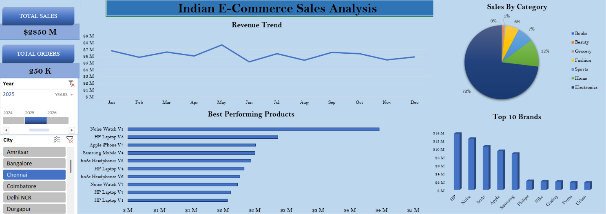

# Indian E-Commerce Sales Analysis
  An interactive dashboard analysing sales, customers, products, brand performance.

## 📌 Project Overview
  This project presents an interactive Indian E-Commerce Sales Analytics dashboard developed using Microsoft Excel. 
  The dashboard analyses sales, customer behaviour, top performing products, categories and brands to provide actionable business insights.

## 🎯 Business Objective
  The objective of the project is the analyse E-Commerce sales and identify:
   - Overall Sales Performance
   - Top performing Brands
   - Top selling Products
   - Best Performing Categories
   - Areas of potential business improvement

## 📊 Dataset
  The project uses multiple datasets containing sales, products and customer information.
### Dataset Files
  | File | Description |
  |---|---|
  | `customers.xlsx` | Customer demographic and registration information |
  | `sales.xlsx` | Order and sales transaction information |
  | `products.xlsx` | Product information |

## 🛠️ Tools & Technologies
  - Microsoft Excel
  - Power Query
  - Power Pivot
  - Pivot Charts
  - Pivot Tables
  - Excel Data Model
  - Slicers
  - Data Analysis

## 🧹 Data Cleaning
  The data preparation was performed using Power Query. The cleaning process included:
    - Correcting data types
    - Standardizing date formats
    - Creating relationships between datasets
    - Preparing the data for analysis

## 📈 Dashboard
  The interactive dashboard provides an overview of:
   - Total Sales
   - Total Orders
   - Total Products
   - Total Customers
   - Revenue Trend
   - Top Performing Brands
   - Top Selling Products
   - Best Performing Categories
Interactive slicers allow users to filter the dashboard by relevant dimensions such as year, city.



## 🔍 Key Insights
  - Sales showed an overall upward trend during 2024 & 2025 but declined after July 2026.
  - Sales performance varied considerably across states.
  - Electronics contributes approximately 72% of total sales indicating the business highly depends on electronics.
  - Noise Watch V1 is the top selling product in most of the states followed by Samsung Mobile V4.
  - HP, Noise, boAt, Samsung, Apple were the leading brands.
  
## 💡 Business Recommendations
  Based on the analysis:
    - Diversify category strategy to reduce dependency on Electronics.
    - Monitor monthly sales growth to identify early performance changes.
    - Plan seasonal promotions around weaker months.

## 🚀 Skills Demonstrated
  - Data Cleaning & Transformation
  - Data Modeling
  - Excel Data Analysis
  - Power Query
  - Power Pivot
  - Dashboard Development
  - KPI Development
  - Trend Analysis
  - Sales Analysis
  - Business Insight Generation
  - Data Visualization
    
## 📁 Project Structure
```text
Excel-Sales-Analysis-Dashboard/
│
├── Data/
│   ├── customers.xlsx
│   ├── products.xlsx
│   └── sales.xlsx 
│
├── Dashboard/
│   └── E commerce sales analytics.xlsx
│
├── Images/
│   └── E commerce sales analytics.png
│
└── README.md
```

## 🙏 Acknowledgements
The dataset used in this project was sourced from Kaggle.
Special thanks to the original dataset creator for making the dataset available for learning and analysis.
🔗 **Dataset Source:** [Kaggle – Indian E-Commerce Sales Dataset](https://www.kaggle.com/datasets/jatinkhandelwal112/indian-e-commerce-sales-analytics-dataset)

